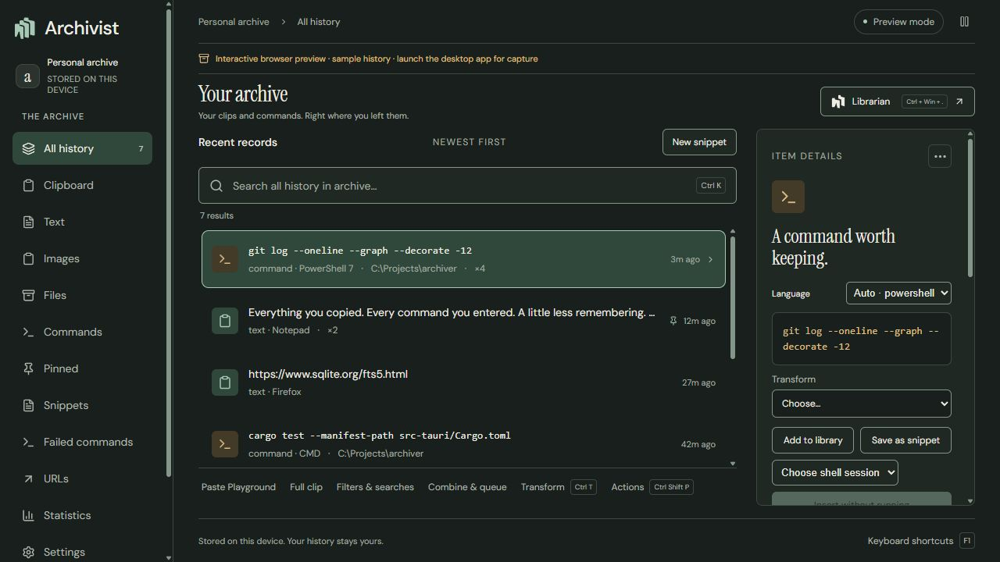
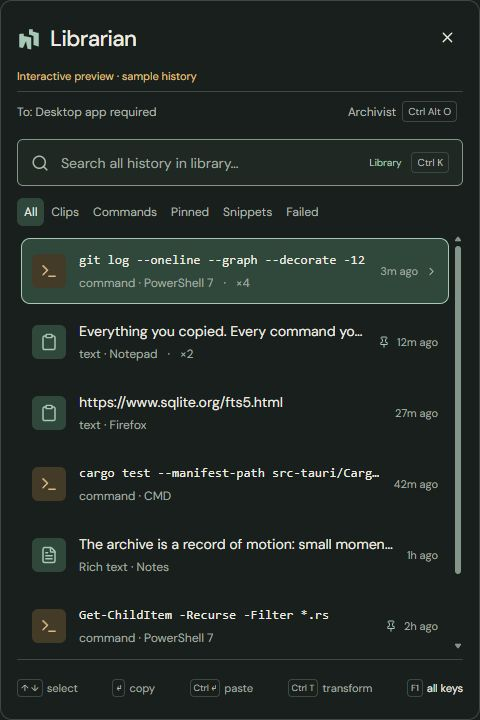

# Archiver

Archiver keeps a searchable local record of clipboard content and shell commands on Windows. It is for developers and other keyboard-heavy users who want to recover a copied fragment, find a command used in a particular directory, or reuse text without reconstructing it from memory.

The project brings clipboard history, command history, and reusable snippets into one desktop app. It separates a small working **library** from the permanent **archive**, so clearing the quick-access list does not erase the underlying history.

**Status:** version 0.1.0, Windows-first development build. Native interaction and compatibility checks remain open; signed releases and a configured update feed are not yet available. See [current status](continuity/status.md).

[Try the demo](#try-the-ui-with-synthetic-data) · [Run on Windows](#run-the-desktop-app-on-windows) · [Checks](#tests-and-checks) · [Documentation](#documentation)

## What you can do

| Capability | Practical example |
| --- | --- |
| Capture clipboard text, rich text, images, and file paths | Find an earlier SQL fragment or copied screenshot, with its source and occurrence history. Clipboard format support has limits described below. |
| Recover shell commands and context | Search for `git`, filter by directory or failed commands, and inspect recorded submissions with exit codes and durations when supplied by the shell hook. |
| Search image text locally | Windows OCR makes recognized screenshot text searchable, with bounded matching excerpts. Automatic scanning and manual extraction are implemented. |
| Keep quick access separate from history | Clear the Librarian's visible library, then search the full archive or undo the latest nonempty clear. Captured content remains stored. |
| Reuse snippets and templates | Save `Project {{project}}` as a named snippet, fill its literal placeholders, and organize snippets into user-defined groups. Notes stay separate from pasted text. |
| Prepare text before reuse | Format JSON, trim whitespace, decode URLs, compare or combine clips, or use Paste Playground. Full clip offers syntax highlighting and Ctrl+F find; explicit edits retain prior text in revisions. |
| Copy, paste, or insert deliberately | Copy a result, paste into the previous application, or insert a command into a connected shell's editing buffer without sending Enter. Native focus restoration still needs interactive validation. |
| Export and automate | Make a JSONL export or verified SQLite backup; use `archiverctl` and its persistent JSON Lines interface from local scripts or agents. |

Additional tools include pins with searchable names, tags, saved searches, terminal transcripts, file/image previews, archive statistics, paste queues, and an offline emoji catalog. [The usage guide](continuity/user/usage.md) covers the full workflows.

## Two desktop surfaces

- **Librarian:** compact quick panel, opened by **Ctrl+Win+Period** by default. It searches the visible library unless you include the full archive with Ctrl+Shift+A.
- **Archivist:** full window for the permanent archive, snippet vault, statistics, settings, and tools. Open it from the Librarian with Ctrl+Alt+O or its button.

In the Librarian, Enter copies and Ctrl+Enter pastes into the previous app; add Shift for plain text. Ctrl+K focuses search, Ctrl+Shift+P opens the command palette, and F1 shows shortcuts. Recognized terminals use the shell insertion workflow instead of general paste. The default global shortcut is configurable; conflicts may prevent registration.

## Screenshots

Real browser captures of the built-in synthetic demo, taken with permission on 2026-10-14. Native capture and delivery are unavailable in this preview; these images do not verify Windows integration.



*Archivist: full archive browsing with source/directory context and selected command details (1280 × 720 browser viewport).*



*Librarian: library search and keyboard hints at its configured 480 × 720 desktop size, rendered in the browser demo.*
## Try the UI with synthetic data

For a first look, only Node.js 24+ and npm are needed. From the project root:

```powershell
npm ci
npm run dev
```

Open <http://127.0.0.1:1439/> for Archivist or <http://127.0.0.1:1439/?quick=1> for Librarian. Stop the server with Ctrl+C.

Outside Tauri, `src/api.ts` supplies built-in synthetic command and clipboard records. This preview does not read your archive or capture the clipboard. Native delivery, OCR, shell connections, backups, and some write operations require the desktop app; the browser preview is not an end-to-end demonstration. Preview items are in memory, while preferences and group definitions can use browser storage.

## Run the desktop app on Windows

### Prerequisites

- Windows 11, the project's target platform.
- Node.js 24+ with npm (the UI helper tests use Node's TypeScript support).
- Rust stable with Cargo and the Windows MSVC toolchain.
- Visual Studio C++ Build Tools with the Desktop development with C++ workload and a Windows SDK.
- Microsoft Edge WebView2 Runtime.
- Windows PowerShell and an installed Windows OCR language for recognition. Shell capture is optional: PowerShell uses PSReadLine; CMD integration requires Clink.

SQLite is bundled through `rusqlite`; no separate database server, account, API key, or external service is required for ordinary local use. See [setup and troubleshooting](continuity/developer/setup.md).

```powershell
# Run from the repository root.
npm ci
npm run desktop
```

`desktop` starts the Tauri development app and Vite frontend. For a release executable without an installer:

```powershell
npm run desktop:build
```

The Windows executable is `target/release/archiver.exe`. To rebuild and start it detached:

```powershell
npm run launch
```

**`launch` forcibly closes any running `archiver.exe` before building.** A failed build leaves it closed. It does not run tests or create an installer. Installer/signing instructions are kept in the [release guide](continuity/developer/release.md).

### Configuration and retained data

The Windows desktop app stores its unencrypted database at `%LOCALAPPDATA%\app.archiver.desktop\archive.sqlite3`, alongside `settings.json`, `capture-state.json`, and shell bridge files. Data has no default expiry. Clipboard capture starts with the native app; close hides the window, while tray **Quit** stops capture.

Use Settings to configure the shortcut, exact executable-name exclusions, OCR behavior, deletion recovery, and optional Librarian state memory. Exclusions are opt-in and do not remove past captures. Deletion recovery defaults to disabled; clearing the library only changes visibility. See [storage and recovery](continuity/user/usage.md#storage-and-recovery).

No `.env` file is required. **`ARCHIVER_DATA_DIR` is a CLI override; the desktop app does not honor it.** For an isolated CLI exercise in PowerShell:

```powershell
# Build the helper without starting desktop capture.
cargo build --manifest-path src-tauri/Cargo.toml --bin archiverctl --target-dir target

# This shell's CLI commands will use a disposable archive under target/.
$env:ARCHIVER_DATA_DIR = Join-Path $PWD 'target\readme-demo'
.\target\debug\archiverctl.exe root
'{"kind":"text","text":"Hello from a local script","source":"readme-demo","timestamp":1792011600000}' |
    .\target\debug\archiverctl.exe contribute
.\target\debug\archiverctl.exe search 'Hello' all 0
Remove-Item Env:ARCHIVER_DATA_DIR
```

The example contains only synthetic ASCII text. The demo database remains under `target/readme-demo`; removing the environment variable restores the CLI default for later calls. `archiverctl serve` provides a persistent **stdio JSON Lines** API, with no HTTP listener or command-execution endpoint. See [CLI syntax and UTF-8 input guidance](continuity/user/cli.md).

Shell capture needs separate opt-in setup. The [shell setup guide](continuity/user/usage.md#shell-setup) explains PowerShell/Clink installation and profile backups; the installer modifies shell profiles. Bash, Zsh, Fish, and WSL adapters are experimental.

## Technologies and engineering decisions

| Layer | Implementation and purpose |
| --- | --- |
| Desktop shell | Tauri 2 owns windows, tray, global shortcuts, native commands, and background capture/OCR workers. |
| Interface | React 19, TypeScript 6, and Vite 7; one app serves both windows through typed wrappers in `src/api.ts`. Shared dialogs, keyboard helpers, and CSS tokens support both light and dark themes. |
| Native core | Rust modules in `src-tauri/src/` implement storage, search, clipboard capture, delivery, previews, OCR, and shell coordination. The desktop executable and CLI share `archiver_core`. |
| Persistence | SQLite with WAL, `synchronous=FULL`, and foreign keys. Content fingerprints deduplicate stored items while occurrences retain source, time, directory, and command-session context. |
| Search | Literal matching plus a scoped fuzzy term index. An FTS5 table is maintained, but current literal queries use SQL `LIKE`; this is not a proven million-event search engine. |
| Shell bridge | Per-user spool files connect hooks to the app. Session/sequence identities make command retries idempotent; insertion requests carry literal text and require acknowledgement. |

Library membership is a separate visibility layer rather than a deletion mechanism. Windows focus checks and terminal guards constrain paste delivery. OCR runs locally through a PowerShell/WinRT helper; URL-title fetching is an explicit network action. JSONL exports and SQLite backups include verification manifests. These decisions and their limits are explained in [architecture](continuity/developer/architecture.md) and the [data model](continuity/data/model.md).

## Tests and checks

Run from the project root after installing prerequisites and dependencies:

| Command | Coverage |
| --- | --- |
| `npm run build` | TypeScript typecheck and production frontend build. |
| `npm run test:ui` | Navigation, Clink Lua behavior, transforms, highlighting, diff, emoji search, and literal text-find helpers. These are not rendered UI tests. |
| `npm run check:rust` | Rust compile check through the project's Cargo wrapper. |
| `npm test` | Rust library tests for persistence, search, history, library scope, recovery, backups, and other core behavior; two opt-in tests are ignored by default. |
| `npm run test:shell` | Isolated PowerShell metadata, pause, multiline insertion, acknowledgement, and expiry checks. |
| `npm run test:setup` | Installer idempotency, backups, uninstall, and preview mode using isolated profiles and a mocked Clink. |
| `npm run test:cli` | Builds the debug CLI and tests commands/stdio against isolated archives. |
| `npm run test:ocr` | Recognizes a generated image with the actual Windows OCR engine; needs an installed recognition language. |

The wrappers add the usual `~/.cargo/bin` location to PATH and put Rust artifacts under root `target/`. For direct Cargo commands, ensure Cargo is on PATH.

[Setup](continuity/developer/setup.md#verify-a-change) records verification evidence and commands not exercised during this documentation pass. Passing helper/core tests does not establish native focus, global shortcut, monitor/DPI, accessibility, or real terminal compatibility; those checks remain tracked in [status](continuity/status.md#pending-human-checks).

## Current limitations and unfinished work

- **Windows-first:** capture, paste, and OCR are Windows-specific. macOS/Linux desktop adapters are future work; Unix shell hooks are experimental.
- **Native validation remains open:** recent snippet/emoji navigation, accumulating detail controls, Ctrl+F, the replacement Archivist shortcut, resize/restore, focus delivery, and real shell editing need interactive checks.
- **Clipboard fidelity is incomplete:** native bitmap/metafile handles, OLE virtual files, and application-private formats need additional adapters. Copied files retain paths rather than becoming independent copies of their contents.
- **Import/restore and diagnostics:** Settings validates portable JSONL/SQLite imports, previews conflicts and merges without duplicates. SQLite replacement requires explicit approval and a verified pre-restore backup; app preferences/profiles stay separate. Capture/storage/shell diagnostics and an explicitly approved PowerShell repair action are implemented; native interaction checks remain pending. Scheduled backups remain deferred.
- **Performance is not established at scale:** fuzzy candidate/indexing limits apply, and large snippet/result loads have unmeasured costs. Existing synthetic checks are not production latency guarantees.
- **Local storage is unencrypted:** copied content and command lines may contain sensitive information. Configure exclusions/pause before using it with sensitive material. Sync is not implemented.
- **Release work remains:** Windows signing, updater keys/feed hosting, and real install/update validation are pending. The development config has no working updater endpoint. Ctrl+R shell search is explicitly deferred.

The [roadmap](continuity/planning/roadmap.md) separates implemented features from the queue; [implemented capabilities](continuity/developer/implemented-features.md) supplies the detailed baseline.

## Documentation

- [Documentation index](continuity/README.md)
- [Usage and shortcuts](continuity/user/usage.md)
- [Build, run, test, and troubleshooting](continuity/developer/setup.md)
- [CLI and agent API](continuity/user/cli.md)
- [Architecture](continuity/developer/architecture.md) and [data model](continuity/data/model.md)
- [Current state and pending human checks](continuity/status.md), [roadmap](continuity/planning/roadmap.md), and [implementation log](continuity/implementation-log.md)
- [Release and signing](continuity/developer/release.md)
- [Contributor/agent instructions](AGENTS.md) and [source map](continuity/agent/map.md)
